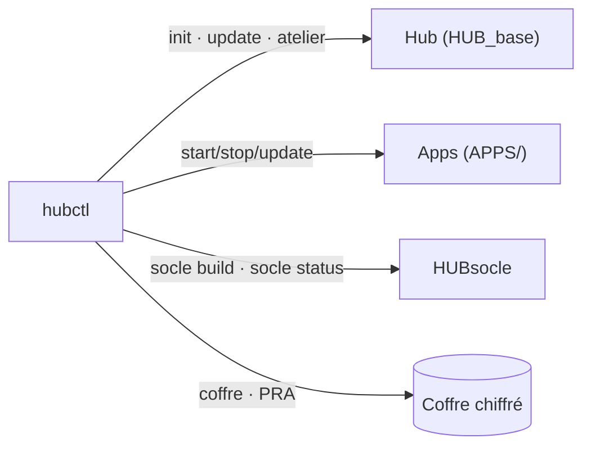

# Hubctl — Pilotage du parc POULIDOR


Outil unique d'administration du parc : **TUI interactive** (dashboard, menus, coffre)
et **CLI non-interactive** pour le déploiement, la mise à jour, les ateliers de
développement, le coffre de secrets et la disaster recovery.

**Stack :** Python 3 + Rich · venv auto-géré par le launcher · aucune installation
manuelle

---

## Ce que fait hubctl

- **Pilotage centralisé** — démarrer/arrêter/mettre à jour le Hub et toutes les apps
  (`make -C` sous le capot), dashboard temps réel : services, disque, apps (version,
  git, statut), alerte PRA.
- **Ateliers de développement** — bac à sable par app : 2e projet compose `<slug>-ws`
  avec clone de la DB prod, test de montées de version (`--maj`), déploiement validé en
  prod (`--prod`), rollback git automatique en cas d'échec.
- **Coffre chiffré** — secrets du parc (Fernet + scrypt), passphrase auto-générée et
  mémorisée, rotation, réplication PRA automatique.
- **Disaster recovery** — park export/restore chiffré, kit PRA (coffre + snapshot du
  Hub) et assistant de restauration sur serveur neuf.
- **Socle** — build local des images HUBsocle et surveillance du drift de la flotte.
- **Extras** — agent de debug IA (Granite/Ollama), gestion VPN WireGuard, trousseau de
  clés JWT du Hub, déploiement convergent d'apps depuis un fichier seed YAML.

## Place dans le parc



Dépôts voisins : [POULIDOR](https://github.com/POULIDOR-Audit-Developpement/POULIDOR)
(méta-repo, héberge le symlink `./hubctl`) ·
[HUB_base](https://github.com/POULIDOR-Audit-Developpement/HUB_base) ·
[HUBsocle](https://github.com/POULIDOR-Audit-Developpement/HUBsocle)

## Démarrage

```bash
./hubctl                 # barre de chargement + TUI (venv créé au premier lancement)
./hubctl --dry-run       # imprime les commandes sans les exécuter
./hubctl --dev / --prod  # forcer le mode (auto-détecté sinon)
```

### Sous-commandes CLI

| Commande | Rôle |
|---|---|
| `start [all\|prod\|dev]` | Démarrer le Hub et/ou les apps |
| `stop [all\|prod\|dev]` | Tout arrêter |
| `update <cible…>` | Mettre à jour une cible : `hub`, un ou plusieurs slugs d'app, `*`/`all` = Hub + toutes les apps (git pull + rebuild + rollback auto ; sans cible : usage, rien n'exécuté) |
| `atelier <app> [--maj] [--prod]` | Cycle atelier d'une app (créer, tester, déployer) |
| `init [--force]` | Bootstrap du Hub (.env, démarrage, health check) |
| `export` / `restore <archive>` | Archive chiffrée du parc complet / restauration |
| `pra-restore [kit]` | Restauration PRA sur serveur neuf (assistant) |
| `vault <backup\|restore\|status\|export\|import\|app>` | Coffre de secrets |
| `jwt <keys\|rotate\|revoke\|cleanup>` | Trousseau de clés JWT du Hub (v0.9.0, HUB_base ≥ 3.59.0) |
| `seed <fichier>` / `seed export` | Déployer/converger des apps depuis YAML / exporter le parc |
| `socle <build\|status>` | Images HUBsocle + drift `APP_SOCLE_VERSION` |
| `vpn <sync\|status\|on\|off>` | WireGuard |
| `debug [app]` | Agent de debug IA (Granite/Ollama) |

Sans sous-commande (TTY requis) : lancement de la TUI. En l'absence de terminal
interactif (cron, pipe), hubctl affiche l'état du hub puis quitte.

## Tests

```bash
cd hubctl_src
hubctl_cli/.venv/bin/pip install pytest
hubctl_cli/.venv/bin/python -m pytest hubctl_cli/tests/ -v    # 30 fichiers (TUI + debug_agent)
```

## Pour aller plus loin

- **[`hubctl_cli/README.md`](hubctl_cli/README.md)** — détail complet : menu TUI, atelier,
  coffre, kit PRA, garde-fous, raccourcis clavier
- [`CHANGELOG.md`](CHANGELOG.md) — historique des versions

---

Projet interne — POULIDOR Audit & Développement.
